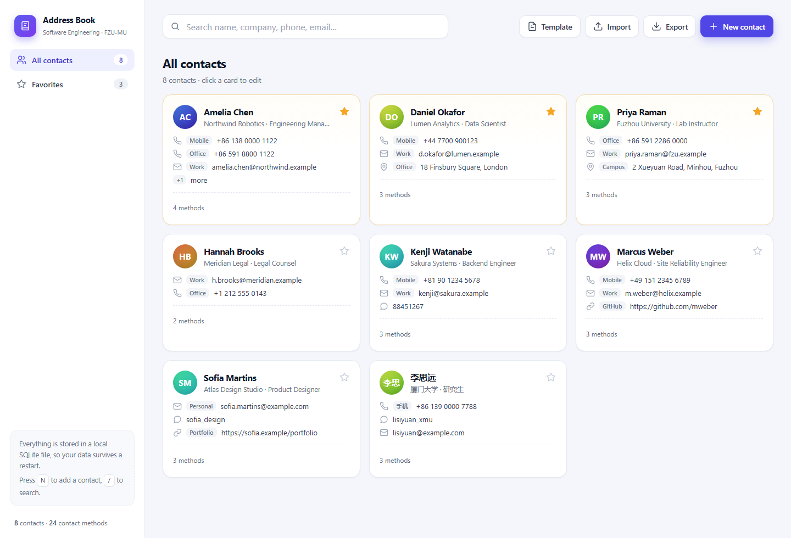

# Address Book

A small, dependency-light address book web application built for the *Software Engineering
(FZU-MU)* Extreme Programming assignment.

It supports starred (bookmarked) contacts, any number of phone numbers / e-mail addresses /
social handles per contact, and a lossless Excel import & export round trip.



## Features

| Assignment requirement | Where it lives |
| --- | --- |
| 1.1 Bookmark contacts | Star button on every card, `Favorites` filter, favourites always sort first |
| 1.2 Multiple contact methods | `contact_methods` table + dynamic method editor (phone, e-mail, WeChat, QQ, address, other) |
| 1.3 Import / export to Excel | `excel_io.py`, `GET /api/export`, `POST /api/import`, downloadable template |
| 1.4 Web deployment (optional) | `Dockerfile`, `--host 0.0.0.0` binding, no external services required |
| Page style | Hand-written CSS, responsive layout, empty states, dialogs, toasts |
| Search | One box searches names, companies, titles, notes **and** every contact-method value |

Additional behaviour worth mentioning:

* **Export** writes one row per contact and one column per kind of information
  (`Phone 1`, `Phone 2`, …), exactly as the assignment asks.
* **Import** is tolerant: column order may change, extra columns are ignored, numbers are
  converted to text, blank rows are skipped, and every bad row is reported with its row
  number instead of aborting the whole import.
* **No duplicate imports**: importing the same sheet twice skips contacts that already exist.
* **Validation** happens on both sides (browser and server); the server is the source of truth.
* **SQLite** keeps the data on disk, so restarting the server loses nothing.

## Technology

* Backend: Python 3.9+ standard library (`http.server`) — no web framework, no ORM.
* Database: SQLite (built into Python).
* Excel: [openpyxl](https://openpyxl.readthedocs.io/) — the only third-party dependency.
* Frontend: vanilla HTML / CSS / JavaScript, no build step, no CDN (works offline).
* Tests: `unittest` (38 tests: repository, Excel, HTTP API).

## Quick start

```bash
git clone <this-repository-url>
cd address-book
python -m pip install -r requirements.txt

python seed.py --reset      # optional: 8 demo contacts
python app.py --open        # http://127.0.0.1:8000/
```

Useful flags:

```bash
python app.py --port 9000              # another port
python app.py --host 0.0.0.0           # expose to the LAN
python app.py --db data/other.db       # another database file
```

Keyboard shortcuts: `N` new contact, `/` focus search, `Esc` close dialog.

## Tests

```bash
python -m unittest discover -s tests -t . -v
```

The suite covers the data layer (validation, ordering, favourites, duplicates), the Excel
round trip (export → import → identical data, template, malformed files) and the HTTP API
(CRUD, search, export/import endpoints, path-traversal protection).

## Project structure

```
address-book/
├── app.py                 # entry point: argument parsing + server startup
├── server.py              # HTTP routing, JSON helpers, static files, multipart uploads
├── repository.py          # validation + data access (AddressBook)
├── db.py                  # SQLite connection and schema
├── excel_io.py            # .xlsx export / import / template
├── seed.py                # demo data
├── static/
│   ├── index.html
│   ├── css/style.css
│   └── js/app.js
├── tests/                 # unittest suite
├── docs/                  # blog post, screenshots, demo script
├── Dockerfile
└── requirements.txt
```

## Database schema

```sql
CREATE TABLE contacts (
    id         INTEGER PRIMARY KEY AUTOINCREMENT,
    name       TEXT    NOT NULL,
    company    TEXT    NOT NULL DEFAULT '',
    title      TEXT    NOT NULL DEFAULT '',
    notes      TEXT    NOT NULL DEFAULT '',
    favorite   INTEGER NOT NULL DEFAULT 0,
    created_at TEXT    NOT NULL,
    updated_at TEXT    NOT NULL
);

CREATE TABLE contact_methods (
    id         INTEGER PRIMARY KEY AUTOINCREMENT,
    contact_id INTEGER NOT NULL REFERENCES contacts (id) ON DELETE CASCADE,
    kind       TEXT    NOT NULL,   -- phone | email | wechat | qq | address | other
    label      TEXT    NOT NULL DEFAULT '',
    value      TEXT    NOT NULL,
    position   INTEGER NOT NULL DEFAULT 0
);
```

A separate table (instead of `phone1`, `phone2`, `email1` columns on `contacts`) keeps the
schema open-ended: adding a new kind of contact method does not require a migration, and the
UI can edit a variable number of rows.

## REST API

| Method | Path | Purpose |
| --- | --- | --- |
| `GET` | `/api/contacts?q=&favorite=1` | List / search contacts, plus global statistics |
| `POST` | `/api/contacts` | Create a contact |
| `GET` | `/api/contacts/{id}` | Read one contact |
| `PUT` | `/api/contacts/{id}` | Update a contact (methods are replaced) |
| `DELETE` | `/api/contacts/{id}` | Delete a contact and its methods |
| `POST` | `/api/contacts/{id}/favorite` | Star / unstar a contact |
| `GET` | `/api/export` | Download every contact as `address-book.xlsx` |
| `GET` | `/api/template` | Download an empty import template |
| `POST` | `/api/import` | Upload an `.xlsx` file (multipart or raw body) |

Request body example:

```json
{
  "name": "Amelia Chen",
  "company": "Northwind Robotics",
  "title": "Engineering Manager",
  "notes": "Prefers short calls on Tuesday mornings.",
  "favorite": true,
  "methods": [
    {"kind": "phone", "label": "Mobile", "value": "+86 138 0000 1122"},
    {"kind": "email", "label": "Work", "value": "amelia.chen@northwind.example"},
    {"kind": "wechat", "label": "", "value": "amelia_chen"}
  ]
}
```

Errors use a consistent shape:

```json
{"error": "Validation failed.", "errors": ["Name is required."]}
```

## Excel format

Export order (one column per kind of information, numbered for repeats):

| Name | Favorite | Company | Title | Notes | Phone 1..3 | Email 1..3 | WeChat 1..2 | QQ 1 | Address 1 | Other 1..2 |
| --- | --- | --- | --- | --- | --- | --- | --- | --- | --- | --- |

Import rules:

1. Row 1 must be a header row containing at least `Name`.
2. Column order may change; unknown columns are ignored.
3. `Favorite` accepts `Yes` / `No` (also `true`, `1`, …).
4. Numbered columns (`Phone 2`, `Email 3`, …) become separate contact methods.
5. A row without a name is reported and skipped; blank rows are ignored; re-importing the
   same sheet does not create duplicates.
6. Labels ("Mobile", "Office") are an in-app concept: a sheet stores one value per numbered
   column, and the importer ignores labels when it checks whether a contact already exists.

## Deployment

The app has no external services, so any small VPS works (the optional cloud-deployment bonus
in the assignment).

```bash
# on the server
git clone <this-repository-url> && cd address-book
python3 -m pip install -r requirements.txt

# run it under systemd / supervisor / tmux
python3 app.py --host 0.0.0.0 --port 8000
```

Docker alternative:

```bash
docker build -t address-book .
docker run -d -p 8000:8000 -v "$PWD/data:/app/data" --name address-book address-book
```

Put nginx in front for TLS and a domain name:

```nginx
server {
    listen 80;
    server_name addressbook.example.com;

    location / {
        proxy_pass http://127.0.0.1:8000;
        proxy_set_header Host $host;
        proxy_set_header X-Forwarded-For $proxy_add_x_forwarded_for;
    }
}
```

Back up the database by copying `data/addressbook.db`; that single file is the whole state.

## License

MIT
