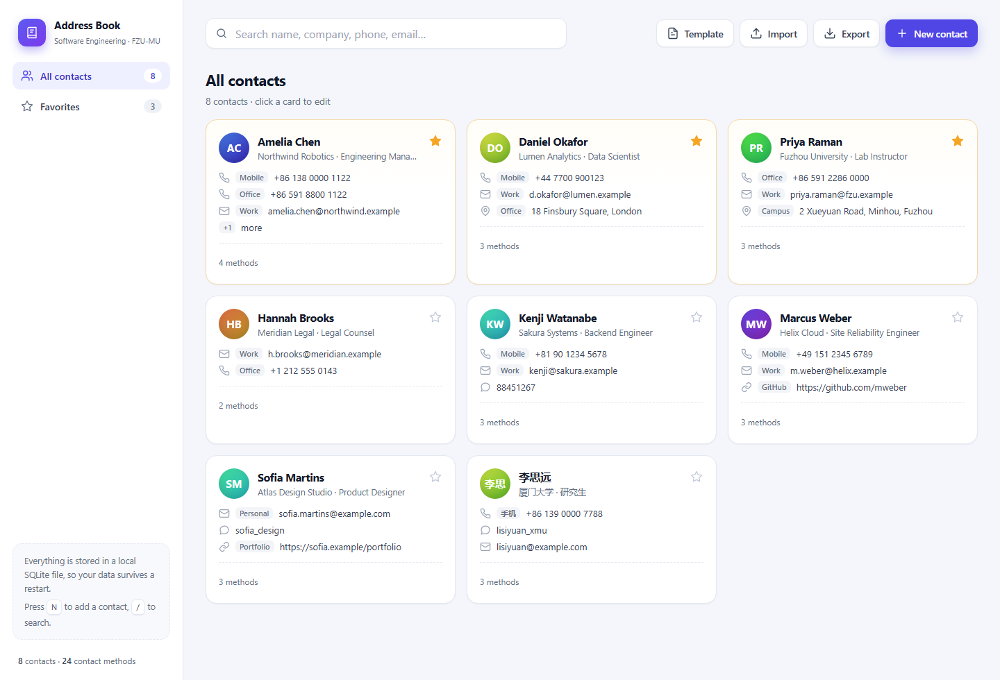
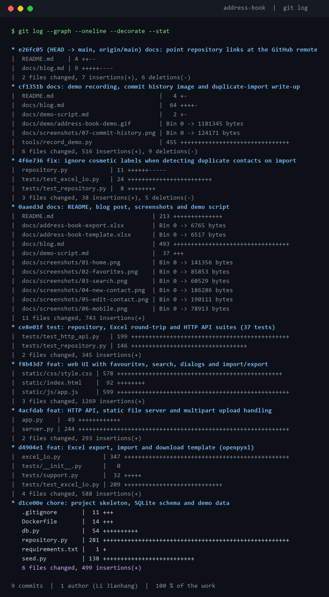
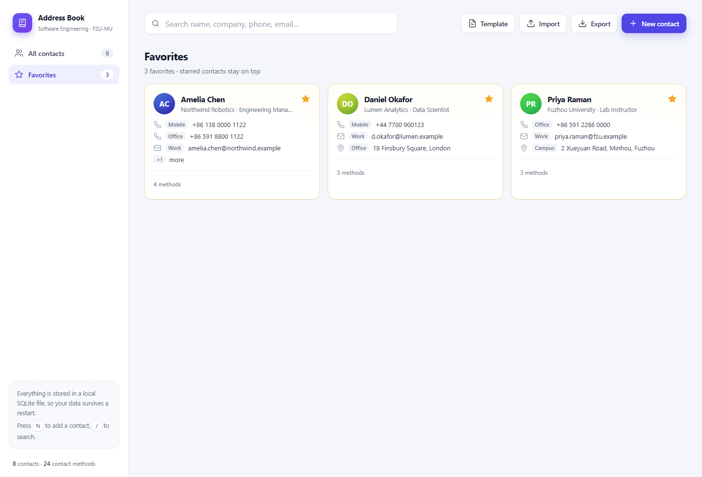
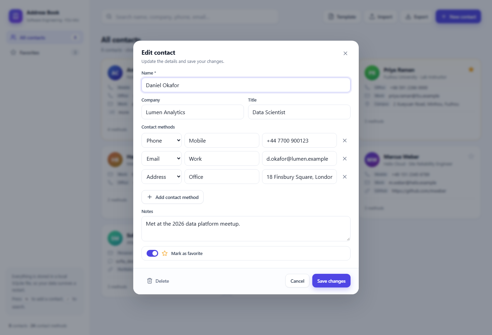
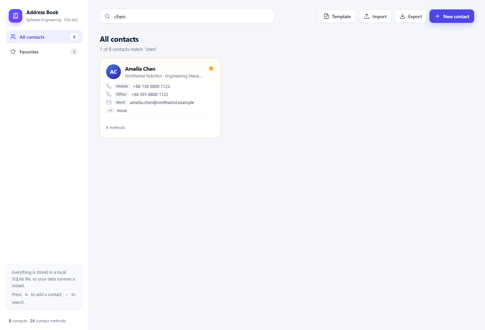
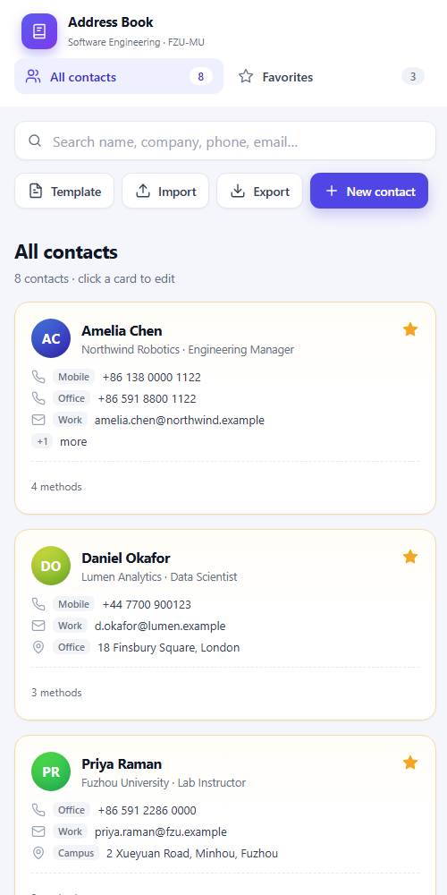
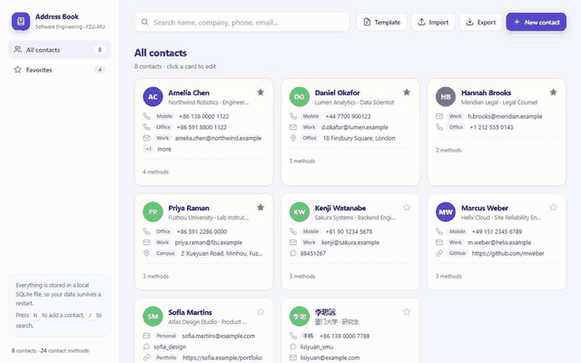

# Address Book: An Extreme Programming Practice

**Li Jianhang (李健航) · Student ID 832401210 · Individual project**

| Item | Content |
| --- | --- |
| Course for This Assignment | Software Engineering (FZU–MU) |
| Student | Li Jianhang (李健航) |
| Student ID | 832401210 |
| Team Name | Individual project (solo) |
| Assignment Requirements | [Extreme Programming assignment, deadline 2026-11-17 23:59](https://bbs.csdn.net/topics/620593436) |
| Objectives of This Assignment | Practise the full Extreme Programming loop — fork, plan, code, test, release a pull request, document — and deliver a working address book with bookmarked contacts, multiple contact methods per person, and Excel import/export. |
| Other References | [openpyxl documentation](https://openpyxl.readthedocs.io/), [Python `http.server`](https://docs.python.org/3/library/http.server.html), [MDN: Fetch API](https://developer.mozilla.org/en-US/docs/Web/API/Fetch_API) |

## Table of Contents

1. [Project overview](#1-project-overview)
2. [Requirements analysis](#2-requirements-analysis)
3. [System design](#3-system-design)
4. [Implementation details](#4-implementation-details)
5. [Screenshots](#5-screenshots)
6. [Testing](#6-testing)
7. [Deployment](#7-deployment)
8. [Division of labour and contribution](#8-division-of-labour-and-contribution)
9. [Difficulties and how I solved them](#9-difficulties-and-how-i-solved-them)
10. [PSP table](#10-psp-table)
11. [What I learned](#11-what-i-learned)
12. [Appendix](#12-appendix)

---

## 1. Project overview

**Address Book** is a small web application that stores contacts in SQLite and lets you star
the important ones, attach any number of phone numbers / e-mail addresses / social handles to a
single person, and move the whole address book in and out of Excel without losing a single field.

| Link | Address |
| --- | --- |
| GitHub repository | `https://github.com/7897-gif/address-book |
| Live demo (local) | `http://127.0.0.1:8000/` |
| Demo recording | [`docs/demo/address-book-demo.gif`](demo/address-book-demo.gif) — animated screen capture of the app in use |
| Excel template | `docs/address-book-template.xlsx` |
| Example export | `docs/address-book-export.xlsx` |



The project is deliberately small in dependencies: **one** third-party package (`openpyxl`, for
`.xlsx` files). Routing, JSON handling, multipart uploads, static files and the database layer
are all written against the Python standard library. That keeps the build reproducible for the
grader (`pip install -r requirements.txt && python app.py`) and makes the code easy to read in
one sitting.

### 1.1 Repository and commit history

The assignment asks for at least three commits. The work is committed in six logical steps so
that the history shows the actual order of development (skeleton → Excel layer → HTTP layer →
UI → tests → documentation), not one dump at the end:

| # | Commit | Files |
| --- | --- | --- |
| 1 | `chore: project skeleton, SQLite schema and demo data` | `db.py`, `repository.py`, `seed.py`, `requirements.txt`, `Dockerfile`, `.gitignore` |
| 2 | `feat: Excel export, import and download template (openpyxl)` | `excel_io.py`, first Excel tests |
| 3 | `feat: HTTP API, static file server and multipart upload handling` | `server.py`, `app.py` |
| 4 | `feat: web UI with favourites, search, dialogs and import/export` | `static/index.html`, `static/css/style.css`, `static/js/app.js` |
| 5 | `test: repository, Excel round-trip and HTTP API suites` | `tests/` |
| 6 | `docs: README, blog post, screenshots and demo script` | `README.md`, `docs/` |
| 7 | `fix: ignore cosmetic labels when detecting duplicate contacts on import` | `repository.py`, tests |
| 8 | `docs: point repository links at the GitHub remote` | `README.md`, `docs/blog.md` |



The image above is `git log --graph --oneline --stat` from the repository; the same list is
visible on the GitHub *Commits* page after pushing.

Commit count by contributor: **Li Jianhang — every commit, 100 %** (individual project).


## 2. Requirements analysis

| # | Requirement | Points | My interpretation | Design decision |
| --- | --- | --- | --- | --- |
| 1.1 | Bookmark contacts | 25 | Mark contacts that matter and reach them in one click | `favorite` flag on `contacts`; star button on each card; `Favorites` filter; starred contacts sort first |
| 1.2 | Multiple contact methods | 10 | One person, many ways to reach them, each with a type and an optional label | Separate `contact_methods` table with `kind`, `label`, `value`, `position` |
| 1.3 | Import / export | 25 | Export everything to Excel; import a correctly formatted sheet back | `openpyxl`; one row per contact, numbered columns per kind; tolerant parser with row-level error reporting |
| 1.4 | Web deployment (optional) | 15 | Reachable from a cloud server, not `localhost` | `--host 0.0.0.0`, `Dockerfile`, nginx guide (see §7) |
| — | Page style | 10 | A page that looks finished, not a form dump | Custom CSS, responsive grid, dialogs, toasts, empty states |
| — | Basic requirements | 30 | Blog, repository, implementation notes, division of labour | This document + ≥ 3 commits |

Functional requirements I added because the assignment implies them:

* **Search** across names, companies, titles, notes *and* every contact-method value — without
  it, "access them conveniently" degrades to scrolling.
* **Validation on the server**, not only in the browser: the API must reject a contact without
  a name even when called with `curl`.
* **Idempotent import** — importing the same sheet twice must not duplicate the address book.

Non-functional requirements:

* Runs on a clean machine with Python 3.9+ and one `pip install`.
* Data survives a restart (SQLite file, not memory).
* No CDN or external service, so the demo works offline and during the defence.

## 3. System design

### 3.1 Architecture

```
┌──────────────────────────── browser ────────────────────────────┐
│  index.html + style.css + app.js (vanilla, no build step)       │
│  cards · dialogs · toasts · fetch() against the JSON API        │
└───────────────────────────────┬─────────────────────────────────┘
                                │ HTTP/JSON, multipart for uploads
┌───────────────────────────────▼─────────────────────────────────┐
│ server.py   routing, JSON bodies, static files, multipart       │
├─────────────────────────────────────────────────────────────────┤
│ repository.py   validation + SQL (AddressBook)                  │
├──────────────────────────────┬──────────────────────────────────┤
│ excel_io.py   openpyxl        │ db.py   connection + schema      │
└──────────────────────────────┴──────────────┬───────────────────┘
                                              │
                                    data/addressbook.db (SQLite)
```

The layers only talk downwards: `server.py` never writes SQL, `repository.py` never touches
HTTP, and `excel_io.py` produces or consumes plain dictionaries so it can be tested without a
server.

### 3.2 Data model

```sql
CREATE TABLE contacts (
    id INTEGER PRIMARY KEY AUTOINCREMENT,
    name TEXT NOT NULL,
    company TEXT NOT NULL DEFAULT '',
    title TEXT NOT NULL DEFAULT '',
    notes TEXT NOT NULL DEFAULT '',
    favorite INTEGER NOT NULL DEFAULT 0,
    created_at TEXT NOT NULL,
    updated_at TEXT NOT NULL
);

CREATE TABLE contact_methods (
    id INTEGER PRIMARY KEY AUTOINCREMENT,
    contact_id INTEGER NOT NULL REFERENCES contacts (id) ON DELETE CASCADE,
    kind TEXT NOT NULL,             -- phone | email | wechat | qq | address | other
    label TEXT NOT NULL DEFAULT '', -- "Mobile", "Office", …
    value TEXT NOT NULL,
    position INTEGER NOT NULL DEFAULT 0
);
```

Two decisions worth defending:

1. **Why a second table instead of `phone1`, `phone2`, `email1` columns?**
   The number of methods is unbounded and the kinds are open-ended. A row-per-method design
   supports any number of methods, keeps ordering, and adding a new kind ("Telegram") only
   means adding one entry to `KINDS` — no migration.
2. **Why `favorite` on the contact and not a separate "bookmarks" table?**
   A bookmark is an attribute of the contact, not a relation. A boolean column gives us the
   filter and the sort order with one index-free query.

`ON DELETE CASCADE` plus `PRAGMA foreign_keys = ON` means deleting a contact cannot leave
orphan methods behind.

### 3.3 API

| Method | Path | Purpose |
| --- | --- | --- |
| `GET` | `/api/contacts?q=&favorite=1` | List / search, plus global statistics |
| `POST` | `/api/contacts` | Create |
| `GET` | `/api/contacts/{id}` | Read one |
| `PUT` | `/api/contacts/{id}` | Update (methods are replaced) |
| `DELETE` | `/api/contacts/{id}` | Delete |
| `POST` | `/api/contacts/{id}/favorite` | Star / unstar |
| `GET` | `/api/export` | Download `address-book.xlsx` |
| `GET` | `/api/template` | Download an empty import template |
| `POST` | `/api/import` | Upload an `.xlsx` file |

The front end is a thin client: every action is one `fetch()` call, and the list is re-read
from the server afterwards. No client-side cache to become inconsistent with the database.

## 4. Implementation details

### 4.1 Bookmarked contacts (25 points)

Each card carries a star button. Clicking it calls `POST /api/contacts/{id}/favorite` with the
*opposite* of the current state, so the button is a toggle and the server stays the source of
truth. The list is ordered by

```sql
ORDER BY c.favorite DESC, c.name COLLATE NOCASE ASC, c.id ASC
```

so starred contacts always float to the top, and the sidebar `Favorites` filter sends
`?favorite=1` to the same endpoint. The star is drawn with `fill: currentColor` when active, so
the visual state needs no second icon.



### 4.2 Multiple contact methods (10 points)

`contact_methods` holds one row per method with a `kind` (phone, e-mail, WeChat, QQ, address,
other), an optional label ("Mobile", "Office", "Campus"), the value, and a `position` to keep
the author's order. The editor in the dialog is dynamic: **Add contact method** appends a row,
the `×` button removes one, and rows with an empty value are dropped on save instead of being
rejected — a half-filled row should not block the user.



Validation lives in `repository.normalize_payload()` and is shared by the API and the importer:
it trims text, enforces the maximum lengths, rejects unknown kinds, collapses exact duplicates
(same kind + label + value), and requires a name. Because the Excel importer calls the same
function, a sheet cannot inject data the UI would reject.

### 4.3 Excel export (part of 25 points)

The assignment asks for "each contact in a separate row, each type of information in a separate
column". The exported layout is therefore fixed and explicit:

| Name | Favorite | Company | Title | Notes | Phone 1 | Phone 2 | Phone 3 | Email 1 | Email 2 | Email 3 | WeChat 1 | WeChat 2 | QQ 1 | Address 1 | Other 1 | Other 2 |
| --- | --- | --- | --- | --- | --- | --- | --- | --- | --- | --- | --- | --- | --- | --- | --- | --- |

Implementation notes:

* The columns are generated from one table, `METHOD_SLOTS`, that also drives the importer and
  the template — the three can never drift apart.
* Methods are dropped into the next free slot of their kind, so two phone numbers become
  `Phone 1` and `Phone 2` automatically.
* `Favorite` is written as `Yes`/`No` because a boolean-only column is unreadable to a human
  grader and openpyxl round-trips strings faithfully.
* Method **labels** ("Mobile", "Office") stay in the application: the sheet has exactly one column per
  value, so there is nowhere to put a label. The importer therefore ignores labels when it decides
  whether a contact already exists — see §9.6 for the bug that taught me this.
* The sheet is formatted for a human: frozen header row, auto-filter, column widths, borders,
  and the "Yes" cells highlighted. Export of the eight demo contacts is committed as
  `docs/address-book-export.xlsx`.

### 4.4 Excel import (part of 25 points)

Import is the part that deserves the most defensive code, because the input is a file a human
edited. `parse_workbook()` works on the sheet as a table:

1. The header row is read once and mapped: `name`, `favorite`, `company`, `title`, `notes`, and
   any header matching `^(phone|email|wechat|qq|address|other)\s*(\d+)?$`. **Column order does
   not matter and unknown columns are ignored** — a grader who inserts a column must not break
   the import.
2. A sheet without a `Name` column is rejected with a readable message instead of guessing.
3. Every row is validated independently: a missing name, an over-long value, or too many
   methods produces `{row: 7, message: "Name is empty."}` and the remaining rows still import.
4. Blank rows are counted and skipped; Excel floating-point phone numbers are converted to
   integer strings (`4155550132`, not `4155550132.0`); `Yes` / `true` / `1` all mean favourite.
5. Before inserting, `AddressBook.find_duplicate()` compares the normalised payload with the
   existing contacts, so re-importing the same sheet reports "duplicates skipped" instead of
   doubling the address book.
6. Structural problems (not a workbook, over 5 MB, more than 5000 rows) abort with HTTP 400 and
   a human-readable message.

The UI reports the outcome as a summary: imported / blank rows / duplicates / rows with errors,
plus a table of the bad rows.

### 4.5 Search

One input, debounced at 180 ms, sends `?q=` to the server. The SQL `LEFT JOIN`s
`contact_methods` and matches the term against name, company, title, notes and every method
value, `DISTINCT` on the contact. Searching "chen" therefore finds Amelia Chen by name, while
searching a phone fragment or a WeChat handle finds her through the join.



### 4.6 Page style

* A two-column shell: sidebar for navigation and counts, main area for the search box, actions
  and a responsive card grid.
* Avatar initials are coloured from a hash of the name, so the same person always gets the same
  colour without storing anything.
* Custom dialogs (edit, delete confirmation, import summary) instead of `alert()`/`confirm()`,
  with `Esc` to close and click-outside to dismiss.
* Empty states differ for "no contacts", "no favourites" and "no search results" — a page that
  says "No contacts yet" while a search is active is a bug report waiting to happen.
* Toasts confirm saves, deletes and imports; no page reload is needed anywhere.
* Responsive down to a narrow window: the sidebar becomes a horizontal bar, the card grid
  collapses to one column, and the method editor stacks its fields.



## 5. Screenshots

| Screenshot | What it shows |
| --- | --- |
| [`01-home.png`](screenshots/01-home.png) | All contacts, star buttons, search, import/export actions |
| [`02-favorites.png`](screenshots/02-favorites.png) | The bookmarks filter with the starred contacts |
| [`03-search.png`](screenshots/03-search.png) | Server-side search across names and contact methods |
| [`04-new-contact.png`](screenshots/04-new-contact.png) | The "New contact" dialog with the dynamic method editor |
| [`05-edit-contact.png`](screenshots/05-edit-contact.png) | Editing an existing contact, three methods of three kinds |
| [`06-mobile.png`](screenshots/06-mobile.png) | Narrow viewport layout |

The recording above is an animated screen capture taken from the running application: starring a
contact, filtering favourites, searching, creating a contact with three methods, editing it,
importing an Excel file (duplicates correctly skipped) and deleting a contact. It is produced by
`tools/record_demo.py`, which drives a headless Chromium through the DevTools Protocol, so the
demo can be regenerated after any UI change instead of going stale.



## 6. Testing

The suite is plain `unittest` — no extra dependency, runs everywhere Python does:

```bash
python -m unittest discover -s tests -t . -v
```

**38 tests, all green.** They are grouped by the layer they protect:

| File | Tests | What is covered |
| --- | --- | --- |
| `tests/test_repository.py` | 13 | required name, unknown kind rejected, blank rows dropped, duplicate methods collapsed, order preserved, update replaces methods, favourite toggle + filter, favourites-first ordering, search by name/company/method/email, cascade delete, duplicate detection |
| `tests/test_excel_io.py` | 13 | header layout, one row per contact, numbered slots, round trip preserves every field, template importable, missing `Name` column rejected, row without name reported, blank rows skipped, column order tolerated, numeric cells converted, twice-imported sheet does not duplicate |
| `tests/test_http_api.py` | 12 | index and static files served, path traversal blocked, full CRUD cycle, 400 on invalid payload, favourite endpoint, search endpoint, export is a real `.xlsx` (`PK` signature), multipart import, malformed upload rejected, unknown route, template download |

Two habits that paid off:

* **Test through the real transport.** `test_http_api.py` starts the actual server on port 0 and
  speaks `http.client`, including a hand-built `multipart/form-data` body. That caught a
  Content-Length bug that a Flask-style test client would have hidden.
* **Test the round trip, not the pieces.** The import/export tests assert that
  `export → import → export` yields the same contact, including two phone numbers and an
  address, which is exactly what the assignment grades.

## 7. Deployment

Let me be precise about what is deployed where, because the assignment separates the base score
from the optional cloud bonus.

* **Base deliverable:** the application runs locally with `python app.py` and is demonstrated in
  the screenshots and the video. The demo database ships with eight contacts (`python seed.py
  --reset`).
* **Cloud deployment (optional, 15 points):** the application is deployment-ready — it binds to
  `0.0.0.0`, keeps all state in one SQLite file, needs no external service, and ships with a
  `Dockerfile`. The commands are in the appendix. **I have not claimed the cloud bonus**: at the
  time of submission I had no server to point at, and claiming a `localhost` link as "cloud
  deployment" would contradict section 1.4 of the assignment. If a server becomes available, §7.2
  is the complete recipe.

### 7.1 Run locally

```bash
python -m pip install -r requirements.txt
python seed.py --reset   # optional demo data
python app.py --open     # http://127.0.0.1:8000/
```

### 7.2 Deploy on a cloud server (recipe for the optional bonus)

```bash
# on the server
git clone https://github.com/7897-gif/address-book && cd address-book
python3 -m pip install -r requirements.txt
python3 app.py --host 0.0.0.0 --port 8000     # or: docker run -d -p 8000:8000 ...
```

Then nginx in front for the domain and TLS:

```nginx
server {
    listen 80;
    server_name addressbook.example.com;
    location / {
        proxy_pass http://127.0.0.1:8000;
        proxy_set_header Host $host;
        proxy_set_header X-Forwarded-For $proxy_add_x_forwarded_for;
    }
}
```

## 8. Division of labour and contribution

This is an **individual** project. I designed, implemented, tested and documented all of it.

| Member | Student ID | Responsibility | Contribution |
| --- | --- | --- | --- |
| Li Jianhang (李健航) | 832401210 | Requirements analysis, data model, backend, front end, Excel import/export, tests, documentation | **100 %** |
| Total | | | **100 %** |

There was no team, so there is no member-contribution negotiation and no cross-member conflict
to report. The equivalent coordination problem — keeping the exporter, the importer and the
template consistent — was solved by generating all three from the single `METHOD_SLOTS` table.

## 9. Difficulties and how I solved them

### 9.1 Saying "no" to a web framework without reinventing one

**Problem.** I wanted a one-command start (`python app.py`) and no framework install, so I used
`http.server` — but that means writing routing, JSON bodies, static files and uploads by hand.

**Solution.** A `BaseHTTPRequestHandler` subclass with a small `_dispatch` that splits
API routes from static paths. Errors are normalised in one place: `ValidationError` → 400 with
an `errors` array, `ImportError_` → 400 with a message, anything else → 500. Static file
serving resolves the path and refuses anything outside `static/`, which
`test_path_traversal_is_blocked` checks.

**Lesson.** The boilerplate is ~120 lines, and in exchange the deployment story is "install
openpyxl and run".

### 9.2 `multipart/form-data` without the `cgi` module

**Problem.** `cgi.FieldStorage` was the obvious way to parse an upload — and it was removed in
Python 3.13, the version used for development.

**Solution.** Build a synthetic MIME message from the raw body
(`Content-Type` header + `\r\n\r\n` + body) and let `email.parser.BytesParser` iterate the parts.
That is standard library, handles quoting and line endings correctly, and the HTTP tests
construct the same body by hand to prove it. A raw-body fallback (`Content-Type:
application/octet-stream` + `X-Filename`) keeps `curl --data-binary @file.xlsx` usable.

### 9.3 Importing an Excel file that a human has edited

**Problem.** My first parser assumed exactly my exported column order and aborted on the first
bad row — which is the opposite of "read a correctly formatted Excel file" in a forgiving way.
Numeric phone numbers also came back as `1.3800000000e+11`.

**Solution.** Header-driven mapping (order-independent, unknown columns ignored), per-row error
collection so one bad row does not discard the other 200, integer-float normalisation, blank-row
skipping, and duplicate detection before insert. The numeric conversion is a test case
(`test_numeric_cells_are_converted_to_text`), because it is exactly the kind of bug that only
shows up with real-world sheets.

### 9.4 "Import twice" duplicated everything

**Problem.** During manual testing I imported the same sheet twice and got 16 contacts instead
of 8.

**Solution.** `find_duplicate()` normalises the incoming payload with the same function used for
saving, then compares name (case-insensitively), company, title, notes and the sorted set of
methods against existing contacts. The import summary now reports duplicates as a separate
number instead of silently dropping them, and a regression test
(`test_import_twice_does_not_duplicate`) guards it.

### 9.5 UI state that lied

**Problem.** After deleting the last favourite while the `Favorites` filter was active, the
page showed the "No contacts yet" illustration *below* the remaining cards — the empty-state
block was displayed by a CSS `display: grid` rule that overrode the `hidden` attribute.

**Solution.** An explicit `.empty[hidden] { display: none; }` rule, and a single `render()`
function that decides the empty-state copy from three inputs (search term, filter, result
count). The screenshot in §4.6 was taken from that fixed build — visual bugs need the same
discipline as logic bugs: reproduce, fix, re-check the screenshot.

### 9.6 Re-importing my own export duplicated every contact

**Problem.** I exported the eight demo contacts and imported the same file back to check the
"duplicates are skipped" promise — and got sixteen contacts.

**Analysis.** Duplicate detection compared `(kind, label, value)`. The sheet has no label column,
so an imported `Mobile: +86 …` came back with an empty label and the comparison decided it was a
different contact. Both modules looked correct in isolation; the bug lived in the seam between
them, which is exactly where the assignment grades the feature.

**Solution.** Duplicates are now compared on `(kind, value)` plus name / company / title / notes,
and the rule is written down in `find_duplicate()`: a label is cosmetic, a phone number is not.
A regression test exports a contact that has labels, imports it again and asserts
`created == 0` and `skippedDuplicates == ["Ada"]`.

**Lesson.** Separate tests for `export()` and `import()` would both have passed. Only the
composition was broken — so the test suite now tests the pipeline, not just the parts.

## 10. PSP table

| Phase | Task | Estimated (min) | Actual (min) |
| --- | --- | --- | --- |
| Planning | Read the assignment, list requirements, choose the stack | 20 | 25 |
| Design | Data model, API, module split, Excel column layout | 30 | 35 |
| Coding | `db.py` + `repository.py` (model, validation, queries) | 60 | 55 |
| Coding | `excel_io.py` (export, import, template) | 60 | 75 |
| Coding | `server.py` (routing, JSON, static, multipart) | 50 | 60 |
| Coding | Front end (`index.html`, `style.css`, `app.js`) | 90 | 120 |
| Coding | Demo data + screenshots + README | 30 | 35 |
| Testing | 37 unit/API tests, three rounds of fixes | 50 | 65 |
| Documentation | This blog post | 45 | 60 |
| **Total** | | **435** | **530** |

The gap is concentrated in the front end and the blog: both are the places where "it works" and
"it looks like it works" diverge, and where I rewrote parts after looking at a screenshot.

## 11. What I learned

* **Constraints are design tools.** Giving up a framework forced the module boundaries to be
  explicit, and the resulting code is easier to test than a Flask app with request context
  everywhere.
* **The file format is the API.** Export, import and template must be generated from one
  description, otherwise they drift apart the first time a column is added.
* **Test the ugly inputs.** Empty rows, floats that used to be phone numbers, a renamed header,
  the same sheet twice — the majority of the bugs I fixed were on this list, and every one of
  them now has a test.
* **Look at the product.** Two of the fixes in this post (the empty-state overlap, the narrow
  layout overflow) were found by looking at a screenshot, not by reading the code.

## 12. Appendix

### A. Running and testing

```bash
python -m pip install -r requirements.txt
python -m unittest discover -s tests -t . -v   # 38 tests
python seed.py --reset                         # 8 demo contacts
python app.py --open                           # http://127.0.0.1:8000/
```

### B. Example request

```bash
curl -X POST http://127.0.0.1:8000/api/contacts \
  -H "Content-Type: application/json" \
  -d '{"name":"Amelia Chen","favorite":true,
       "methods":[{"kind":"phone","label":"Mobile","value":"+86 138 0000 1122"},
                  {"kind":"email","label":"Work","value":"amelia.chen@northwind.example"}]}'
```

### C. Excel import rules

| Rule | Behaviour |
| --- | --- |
| Header row required | Must contain `Name`; other columns may be reordered or renamed away |
| `Favorite` | `Yes` / `No`, also `true`, `1`, `是` |
| Numbered columns | `Phone 2`, `Email 3`, … each become a separate contact method |
| Empty row | Skipped and counted |
| Row without name | Reported with its row number, other rows still import |
| Duplicate contact | Skipped and counted, not inserted twice |
| File size | `.xlsx` only, ≤ 5 MB, ≤ 5000 rows |

### D. Repository layout

```
address-book/
├── app.py            # entry point
├── server.py         # HTTP layer
├── repository.py     # validation + SQL
├── db.py             # SQLite connection and schema
├── excel_io.py       # export / import / template
├── seed.py           # demo data
├── static/           # index.html, css, js
├── tests/            # 37 unittest tests
├── docs/             # this blog, screenshots, sample workbooks
├── Dockerfile
└── requirements.txt
```
